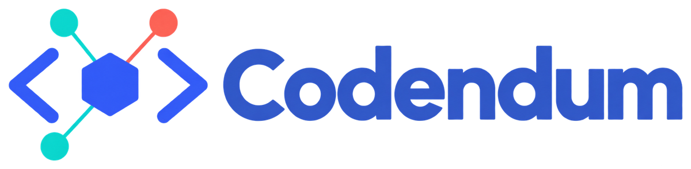
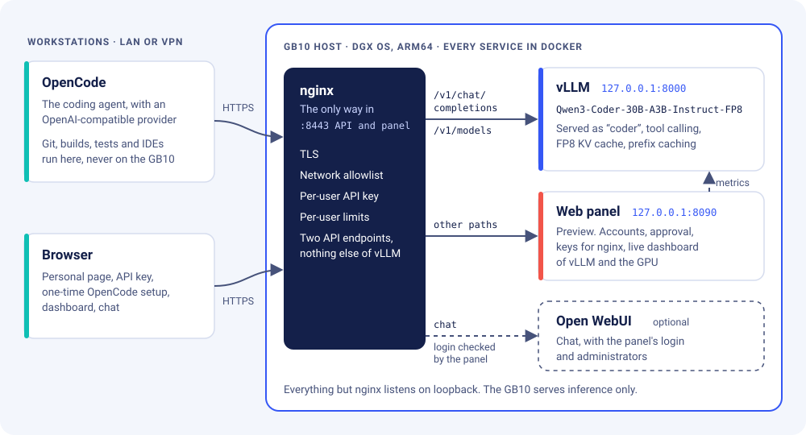
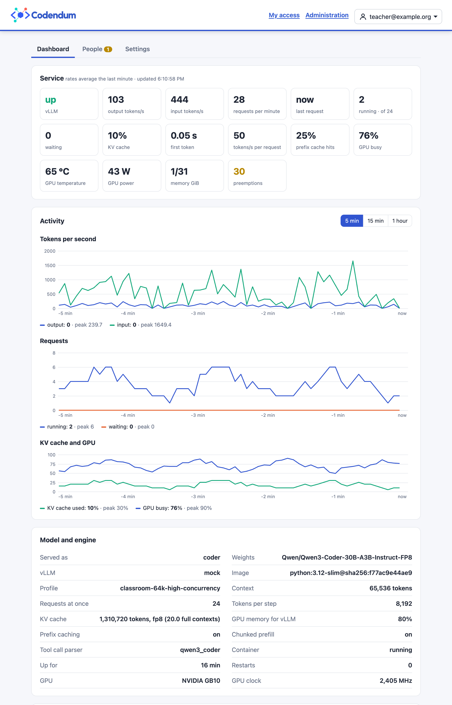
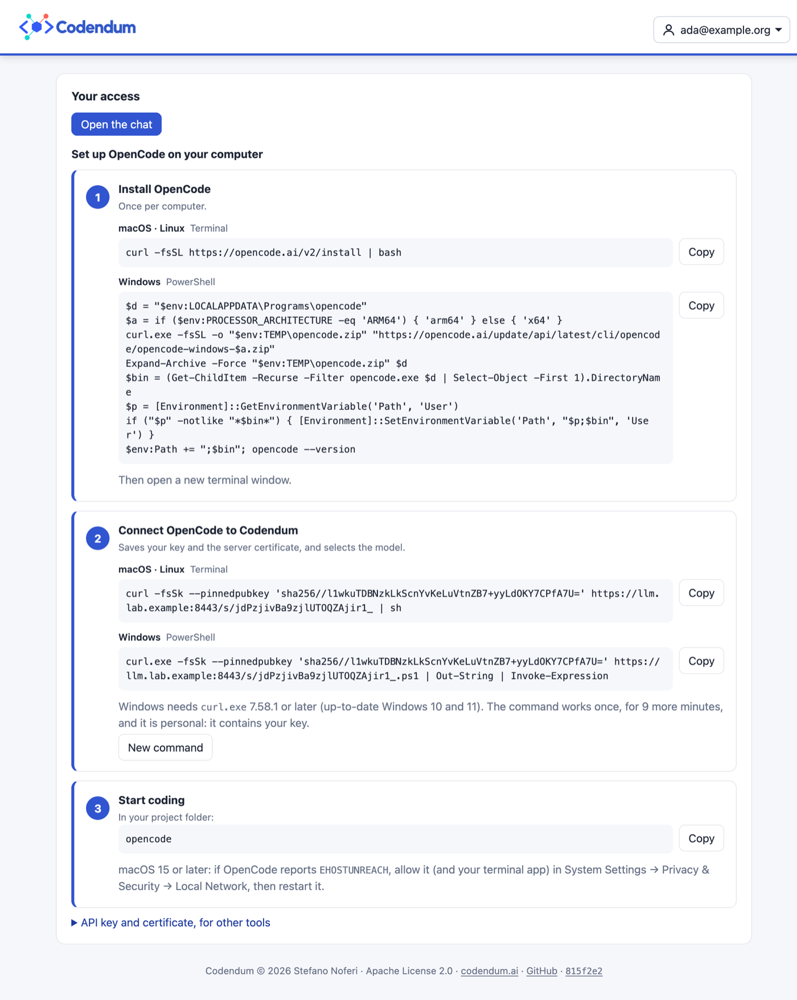

<h1 align="center">
  
</h1>

Shared, local infrastructure for coding agents. A single NVIDIA GB10 system
(DGX Spark) runs [vLLM](https://docs.vllm.ai/) with a coding model, and
concurrent users run [OpenCode](https://opencode.ai/) on their own workstations
against it. It works the same for a classroom or a company team: prompts and source code
stay on the organization's network.

The repository contains scripts, example configuration and documentation to
install the service, secure it, test it, measure it and operate it.

> **Status: 0.2.0.** CI tests every script and configuration file
> offline. The service has also run on one GB10 with a simulated class of
> concurrent OpenCode users (see [Benchmarks](docs/benchmark.md#measured-on-a-gb10)). Treat those figures
> as a reference for this model and client version, not as a promise of
> performance.
>
> A [web panel](docs/web.md) for registration, keys, OpenCode setup and a live
> dashboard is included as a preview.

## How it works

<p align="center">
  
</p>

- **The GB10 only serves inference.** Users' code, version control, compilers,
  interpreters, package managers, builds and tests run on the workstations or in
  dedicated isolated development environments, whatever the language or
  platform. Do not run users' builds on the model host: CPU and GPU share the
  same memory.
- **Every service runs in Docker.** vLLM listens on the loopback interface only,
  and an nginx container is the only way in. nginx accepts HTTPS on a dedicated
  port from the organization's LAN or VPN, checks a per-user API key and
  forwards only `/v1/chat/completions` and `/v1/models`. The scripts in this
  repository run on the host: they drive Docker and act as test clients, and
  they install nothing on the system.
- **OpenCode uses an explicit OpenAI-compatible provider.** The served model name
  is `coder`, tool calling is enabled explicitly, and the context limit matches
  the server profile.

## Web panel (preview)

The [web panel](docs/web.md) handles the class from the browser. People
register, get their key and connect OpenCode with one command. Administrators
approve people and follow vLLM, the GPU and the users live.

<p align="center">
  
</p>
<p align="center">
  
</p>

<sub>Screenshots from the test setup, with example accounts, a mock vLLM and a
simulated GPU: the figures are not measurements.</sub>

## Quick start

On the GB10 host, with Docker and the NVIDIA runtime that DGX OS provides:

```bash
git clone https://github.com/stefanoferi/codendum.git
cd codendum
scripts/preflight.sh
cp .env.example .env
scripts/start-vllm.sh --wait
scripts/start-proxy.sh --init
scripts/start-proxy.sh
scripts/smoke-test.sh
```

Before `start-proxy.sh`, review `.env` and install three things:

- the host name and allowed networks in the proxy configuration;
- a TLS certificate;
- per-user API keys from `scripts/gen-api-keys.sh`.

The [installation guide](docs/installation.md) and the
[proxy guide](docs/proxy.md) explain every step. Then configure OpenCode on each
workstation from the server's own limits:

```bash
scripts/configure-opencode.sh --base-url https://llm.lab.example:8443
```

## Documentation

The documentation is published at <https://stefanoferi.github.io/codendum/>.
Its sources in [`docs/`](docs/) are Markdown files built with
[Sphinx](https://www.sphinx-doc.org/) and
[MyST](https://myst-parser.readthedocs.io/).

| Page | Contents |
| --- | --- |
| [Sizing](docs/sizing.md) | Unified memory, KV cache per token, connected vs active vs waiting users |
| [Installation](docs/installation.md) | Prerequisites, configuration, launching and upgrading vLLM |
| [HTTPS proxy](docs/proxy.md) | nginx container, API keys, limits, queueing and fairness |
| [OpenCode](docs/opencode.md) | Provider configuration and a real read-edit-test check |
| [Smoke test](docs/smoke-test.md) | Health, streaming and tool-call checks |
| [Benchmarks](docs/benchmark.md) | Load tests, the classroom simulation and results measured on a GB10 |
| [Profiles](docs/profiles.md) | Serving profiles and how to switch them |
| [Troubleshooting](docs/troubleshooting.md) | Common failures, logs and what to do |
| [Security and limits](docs/security.md) | Threat model and responsibilities |
| [Governance](docs/governance.md) | What is governed today, and a possible future integration with [Admina](https://admina.org/) |
| [Reference](docs/reference.md) | Components, pinned versions, licenses, compatibility, sources |

To build the HTML site locally:

```bash
python3 -m venv .venv
.venv/bin/pip install --require-hashes -r docs/requirements.txt
.venv/bin/sphinx-build -W --keep-going -b html docs docs/_build/html
```

## Roadmap

A possible next step is governance of the content that goes through the model:
personal-data redaction, a prompt-injection firewall, agent loop breaking and a
tamper-evident audit log. It could be provided by integrating
[Admina](https://admina.org/), an open-source framework for governed AI, as a
gateway between the proxy and vLLM. See [Governance](docs/governance.md). The
integration is not implemented yet.

## Contributing and security

Contributions are welcome: see [CONTRIBUTING.md](CONTRIBUTING.md) and the
[Code of Conduct](CODE_OF_CONDUCT.md). Report vulnerabilities privately as
described in [SECURITY.md](SECURITY.md).

## License

Codendum is licensed under the [Apache License 2.0](LICENSE); see also
[NOTICE](NOTICE). Container images, model weights and client software are
downloaded separately and keep their own licenses: see
[Reference](docs/reference.md#components-versions-and-licenses).

Created and maintained by [Stefano Noferi](https://noferi.it/) (GitHub:
[`stefanoferi`](https://github.com/stefanoferi)).
